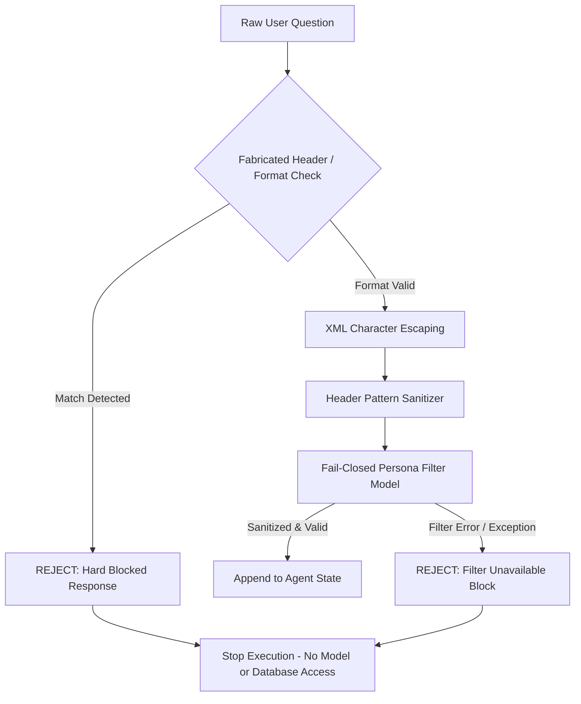
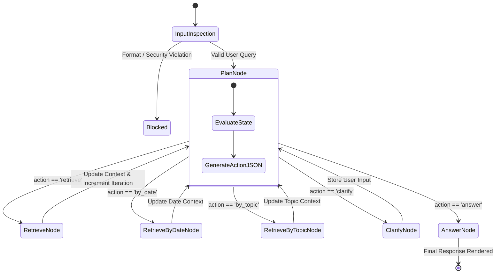
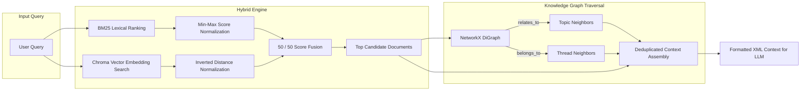
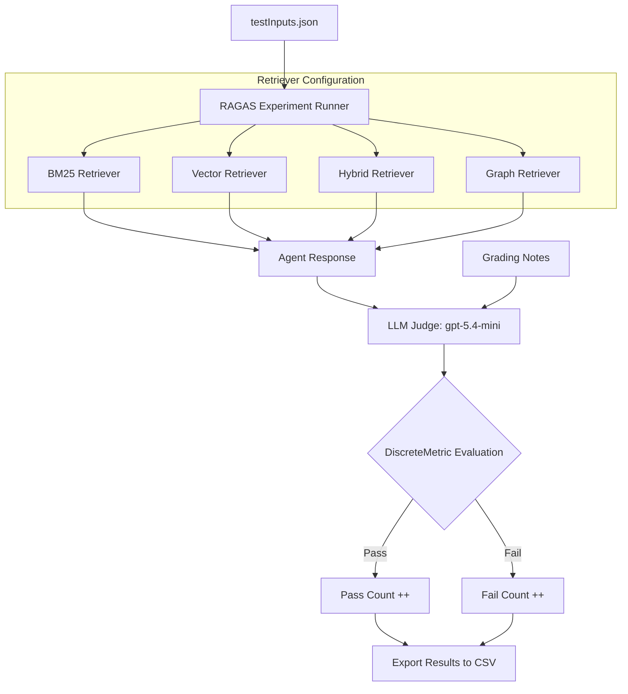

# Designing and Evaluating an Enterprise RAG System

An enterprise-grade, security-hardened Retrieval-Augmented Generation (RAG) system bounded strictly to local **WikiFiles** document repositories. This project features stateful agentic orchestration with **LangGraph**, multi-stage hybrid search, NetworkX knowledge graph traversal, pre-retrieval security guardrails, and an automated **RAGAS** benchmark evaluation harness.

---

## Table of Contents
- [Overview](#overview)
- [System Architecture & Flowcharts](#system-architecture--flowcharts)
  - [1. Pre-Retrieval Security Guardrail Pipeline](#1-pre-retrieval-security-guardrail-pipeline)
  - [2. LangGraph Stateful Agent Flow](#2-langgraph-stateful-agent-flow)
  - [3. Hybrid & Graph-Augmented Retrieval Pipeline](#3-hybrid--graph-augmented-retrieval-pipeline)
  - [4. RAGAS Benchmark Evaluation Harness](#4-ragas-benchmark-evaluation-harness)
- [Project Directory Structure](#project-directory-structure)
- [Environment Setup & Installation](#environment-setup--installation)
- [How to Run the Code](#how-to-run-the-code)
  - [Option A: Interactive CLI Launcher (Recommended)](#option-a-interactive-cli-launcher-recommended)
  - [Option B: Safe RAG Agent Execution](#option-b-safe-rag-agent-execution)
  - [Option C: RAGAS Evaluation Suite](#option-c-ragas-evaluation-suite)
  - [Option D: Offline Security Self-Check](#option-d-offline-security-self-check)
- [Engineering Decisions & Model Routing](#engineering-decisions--model-routing)

---

## Overview

### What Problem Does It Solve?
Enterprise Q&A assistants operating on internal documentation face key operational and reliability challenges:
- **Unbounded Model Speculation**: Off-the-shelf LLMs risk outputting unverified external facts beyond enterprise boundaries.
- **Unsanitized Context & Formatting Hijacking**: Single-pass pipelines can be vulnerable to untrusted document formats or persona overrides.
- **Single-Pass Search Limitations**: Complex or multi-part queries require iterative planning, query splitting, and clarification loops rather than simple vector lookup.

### Core System Features
- **Strict Corpus Grounding**: Operates exclusively on local `WikiFiles` repositories with explicit refusal outputs for out-of-scope questions.
- **Pre-Retrieval Security Stack**: Rejects fabricated document blocks and prompt overrides prior to retrieval, enforces XML trust boundaries, and runs a fail-closed persona filter.
- **Multi-Strategy Hybrid Retrieval**: Combines BM25 lexical keyword scoring with Chroma vector similarity embeddings (50/50 score normalization).
- **NetworkX Graph Augmentation**: Explores entity and topic connections (`relates_to`) alongside conversation threads (`belongs_to`) across structured WikiFile metadata.
- **LangGraph Agentic Planning**: Uses a stateful `StateGraph` over `_AgentState` for multi-step retrieval, date filtering, topic lookup, and multi-turn user conversation state.
- **RAGAS Evaluation Harness**: Benchmarks retrieval and generation accuracy using an LLM judge (`gpt-5.4-mini`) scoring discrete pass/fail metrics against reference grading rubrics.

---

## System Architecture & Flowcharts

### 1. Pre-Retrieval Security Guardrail Pipeline

User inputs undergo multi-stage verification before entering the agent state or retrieval memory.



---

### 2. LangGraph Stateful Agent Flow

Orchestration is managed by a `StateGraph` operating on `_AgentState`.



---

### 3. Hybrid & Graph-Augmented Retrieval Pipeline

Retrieval merges lexical scores and semantic embeddings into a candidate pool, with optional NetworkX graph traversal.



---

### 4. RAGAS Benchmark Evaluation Harness

Evaluation measures accuracy across BM25, Vector, Hybrid, and Graph retrieval strategies against reference grading notes.



---

## Project Directory Structure

```text
.
├── main.py                           # CLI Launcher (Interactive menu for Retrieval / Testing)
├── retriever.py          # Safe RAG Agent implementation (LangGraph, Hybrid Search, Guardrails)
├── retrieval_Graph_Diagnosis.py    # RAGAS evaluation harness & NetworkX Graph Retriever
├── AgentState.py                            # TypedDict definition (_AgentState) for state persistence
├── testInputs.json                          # Benchmark evaluation dataset (queries + grading notes)
├── annotatedWikiFiles.json                  # Graph node & edge annotations for NetworkX
├── WikiFiles/                               # Primary production WikiFiles text corpus
├── WikiFiles_Test/                          # Benchmark evaluation WikiFiles text corpus
├── chroma_db/                               # Production Chroma DB directory
├── chroma_db_Test/                          # Benchmark Chroma DB directory
├── ragas_experiments/                       # Output experiment reports and CSV logs
├── requirements.txt                         # Dependency requirements
└── .env                                     # API key environment configuration
```

---

## Environment Setup & Installation

### 1. Virtual Environment Setup

**Option 1: Using Python `venv`**
```bash
python -m venv .venv

# Activate on Linux/macOS:
source .venv/bin/activate

# Activate on Windows:
.venv\Scripts\activate
```

**Option 2: Using Conda**
```bash
conda env create -f environment.yml
conda activate ragcourse
```

### 2. Dependency Installation
```bash
python -m pip install --upgrade pip
pip install -r requirements.txt
pip install networkx
```

### 3. OpenRouter API Key Configuration
Create a `.env` file in the root directory:
```bash
OPENROUTER_API_KEY=sk-or-your-openrouter-key-here
```
Or export it directly in your shell environment:
```bash
export OPENROUTER_API_KEY=sk-or-your-openrouter-key-here
```

---

## How to Run the Code

### Option A: Interactive CLI Launcher (Recommended)
Launch the primary interface menu:
```bash
python main.py
```
**Menu Selections:**
1. **Retrieval**: Interactive chat mode with the safe research agent.
2. **Testing**: RAGAS graph diagnosis evaluation suite on test inputs.
3. **Exit**: Terminate program.

---

### Option B: Safe RAG Agent Execution

**Interactive Chat Mode:**
```bash
python retriever.py WikiFiles --chat
```

**Guardrail & Security Demonstration:**
Run without flags to replay standard edge-case prompts against the security stack:
```bash
python retriever.py WikiFiles
```

---

### Option C: RAGAS Evaluation Suite

Run benchmark scoring for a specific retrieval strategy:

```bash
# Graph Retriever
python retrieval_Graph_Diagnosis.py graph WikiFiles_Test --inputs testInputs.json

# Hybrid Retriever
python retrieval_Graph_Diagnosis.py hybrid WikiFiles_Test --inputs testInputs.json

# Lexical BM25 Retriever
python retrieval_Graph_Diagnosis.py bm25 WikiFiles_Test --inputs testInputs.json

# Vector Retriever
python retrieval_Graph_Diagnosis.py vector WikiFiles_Test --inputs testInputs.json
```

Results are saved as CSV spreadsheets under `ragas_experiments/experiments/`.

---

## Option D: Offline Security Self-Check

Execute the offline regression test suite (verifies XML escaping, regex filters, and header sanitization without making network calls):

```bash
python -c "import retriever as s; s._self_check()"
```

---

## Engineering Decisions & Model Routing

| Architecture Decision | Rationale | Trade-offs / Benchmark Findings |
| :--- | :--- | :--- |
| **LangGraph Agent vs. Single-Pass RAG** | Single-pass retrieval struggles on complex multi-part queries. LangGraph state persistence enables multi-step planning and clarification loops. | Increases input-to-output token ratio (~91.7:1) but ensures complete factual context. |
| **Pre-Retrieval Guardrail Stack** | Filtering untrusted patterns prior to retrieval stops malformed inputs before they reach vector storage or LLMs. | Fail-closed policy blocks requests if security filters encounter runtime errors, favoring compliance over uptime. |
| **Per-Role Model Routing** | Employs high-reasoning models (`gpt-5.4-mini`) for planning/answering and lightweight models (`gpt-5.4-nano`) for guardrails. | Reduces per-run API cost ($0.0151 vs $0.98 for Pro models) while maintaining full precision. |
| **Hybrid BM25 + Vector Retrieval** | Merges keyword accuracy (dates, acronyms) with semantic vector embeddings using 50/50 score normalization. | Outperforms standalone vector search on structured enterprise metadata. |
